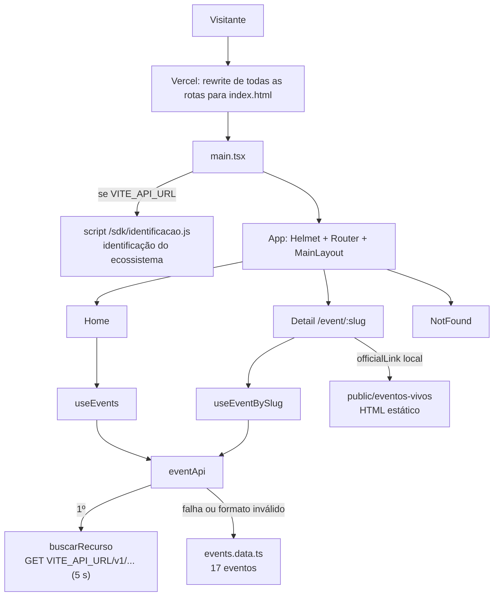
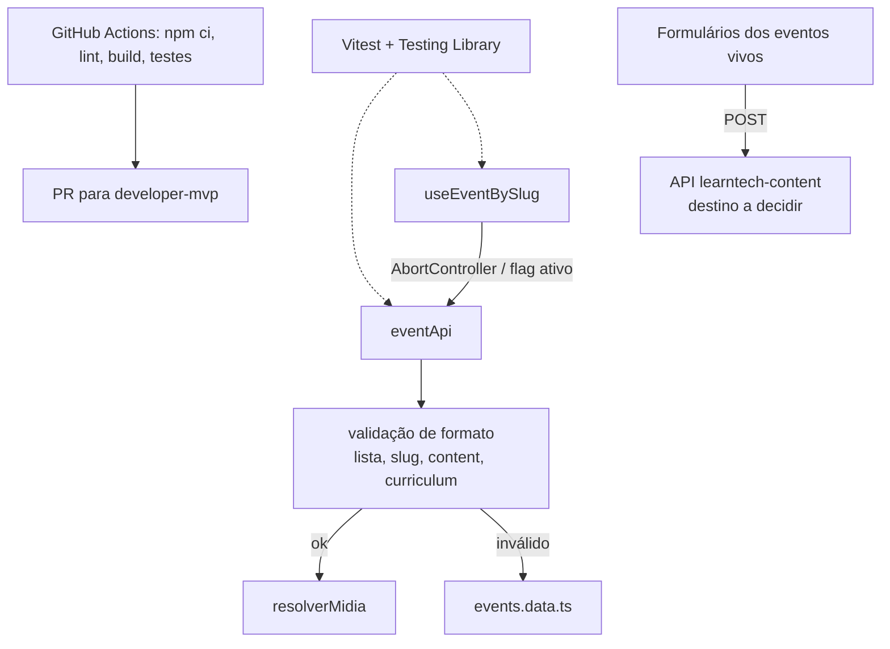

# 02 · Arquitetura e plano de melhorias — bootcamps

Data: 27/10/2026

## 1. Arquitetura atual

Regras de negócio encontradas (todas **inferido · confirmar**):

| Regra | Onde |
| --- | --- |
| Concluído = verde (emerald); desejado = âmbar, em todos os pontos de contato | `readme.md`, `context.txt`, componentes |
| Com `VITE_API_URL`, o site injeta o script de identificação do ecossistema (nome e e-mail, sem login), com link de privacidade — mede/identifica o público; **não remover** | `learntechContent.ts:30-40` |
| Sem `VITE_API_URL`, o site funciona só com dados locais e sem identificação | `.env.example` |
| Inscrição no BQ Café e Tecnologia pede nome, e-mail, WhatsApp e stack — coleta é regra de negócio | `bq-agenda-tech/index.html` |
| ByteClass troca e-mail pela Grade Técnica M1–M5 (PDF) | `byteclass.dev/index.html` |

## 2. Arquitetura alvo

Mesma estrutura FSD e mesmo produto. Muda só a rede de segurança e a robustez.

## 3. Decisões (ADR curto)

### ADR-01 · Validar formato da resposta da API antes de usar

| Campo | Conteúdo |
| --- | --- |
| Contexto | `buscarRecurso` faz `as T` sem checar. Um objeto no lugar de lista quebrava a Home em `events.filter`; um evento sem `curriculum` quebrava o Detail em `.length` |
| Decisão | Checagem mínima em `eventApi` (lista; `slug` string, `content` e `curriculum` array). Formato inválido cai no mesmo fallback local que já existia |
| Alternativas | Zod (dependência nova, fora do lote 1); validação campo a campo (excesso hoje) |
| Consequências | Sem mudança visível. Se a API mudar de formato, o site mostra os dados locais e avisa no console (só quando `VITE_API_URL` existe) |

### ADR-02 · CI só com scripts existentes

| Campo | Conteúdo |
| --- | --- |
| Contexto | Não havia CI; o README promete "build e checagem de tipos limpos" sem nada que garanta |
| Decisão | `.github/workflows/ci.yml` com `npm ci`, `npm run lint`, `npm run build`, Node 22 (Vite 7 exige Node 20.19+ ou 22.12+) |
| Alternativas | Só build (esconde lint); incluir testes (não existem) |
| Consequências | Se o lint estiver vermelho hoje (ver R3), o primeiro push mostra X vermelho. Não bloqueia deploy da Vercel |

### ADR-03 · Formulários com coleta são regra de negócio

| Campo | Conteúdo |
| --- | --- |
| Contexto | Os dois formulários dos eventos vivos não guardam nada; o BQ ainda confirma sucesso |
| Decisão | Não remover nem alterar no lote 1. Propor destino real + aviso de privacidade |
| Alternativas | Remover o formulário (proibido: regra de negócio); trocar por link Sympla (decisão do dono) |
| Consequências | Até a decisão, inscrições continuam se perdendo |

### ADR-04 · Testes com Vitest (proposto)

| Campo | Conteúdo |
| --- | --- |
| Contexto | Projeto Vite, sem testes |
| Decisão | Vitest + @testing-library/react + jsdom, scripts `test` e `test:run` |
| Alternativas | Jest (configuração extra com ESM/Vite); Playwright só (lento para lógica) |
| Consequências | 3 dependências de desenvolvimento novas — por isso fica para o lote 2, com aprovação |

## 4. Plano em lotes

Ordem: rede de segurança → testes → robustez e desempenho → documentação.

| ID | Item | Motivo | Arquivos | Critério de pronto | Esforço | Risco | Muda o produto? | Situação |
| --- | --- | --- | --- | --- | --- | --- | --- | --- |
| S1 | CI com lint + build | Rede de segurança | `.github/workflows/ci.yml` | Workflow verde em PR | P | Baixo | não | **executado no lote 1** |
| S2 | Script local de verificação | Dono verificar no Windows | `docs/claudeia/verificar.ps1` | Script roda até o fim | P | Baixo | não | **executado no lote 1** |
| S3 | Deixar o lint verde (react-hooks 7) | CI confiável | `useEventBySlug.ts`, `useEvents.ts` | `npm run lint` sem erro | P | Baixo | não | proposto |
| T1 | Instalar Vitest + Testing Library | Base de testes | `package.json`, `vite.config.ts` | `npm test` roda | P | Baixo | não | proposto (dep. nova) |
| T2 | Testes de `eventApi` (API ok, API fora, formato inválido, slug inexistente) | Proteger fallback | `eventApi.test.ts` | 4 casos verdes | P | Baixo | não | proposto |
| T3 | Testes de Home (contagem 14/3, grupos) e Detail (404, verde/âmbar, certificado) | Proteger regra central | `*.test.tsx` | Casos verdes | M | Baixo | não | proposto |
| T4 | Teste de integridade do catálogo (slugs únicos, ids únicos, `officialLink` não vazio) | Conteúdo | `events.data.test.ts` | Verde | P | Baixo | não | proposto |
| R1 | Validação de formato da resposta da API | Robustez | `eventApi.ts` | Home/Detail não quebram com JSON fora do formato | P | Baixo | não | **executado no lote 1** |
| R2 | Erro de JS em `href="#"` no ByteClass | Robustez | `byteclass.dev/main.js` | Clique em "#" sem erro no console | P | Baixo | não | **executado no lote 1** |
| R3 | `useEventBySlug` com cancelamento, limpar `event` ao trocar slug | Corrida entre respostas | `useEventBySlug.ts` | Troca rápida de slug mostra o evento certo | P | Baixo | não | proposto |
| R4 | `og:image`/`og:url` absolutos + `canonical` | Prévia social | `Detail.tsx`, `index.html` | Validador de OG mostra imagem | P | Baixo | não | proposto |
| R5 | Cabeçalhos de segurança no `vercel.json` (`X-Content-Type-Options`, `Referrer-Policy`, CSP em modo report-only) | Segurança | `vercel.json` | Headers visíveis no DevTools | M | Médio (CSP pode bloquear SDK/Fonts/YouTube) | não | proposto |
| R6 | `innerHTML` → criação de nós (ou escape) nos sites estáticos | Prevenir XSS futuro | `script.js`, `main.js` | Mesmo HTML gerado | P | Baixo | não | proposto |
| P1 | Converter PNGs do ByteClass para WebP | 11 MB | `byteclass.dev/assets/*`, `index.html`, `style.css` | < 2 MB, mesma aparência | M | Baixo | não (visual igual) | proposto |
| P2 | Recomprimir JPGs de `instituicoes/` | 4,1 MB | `src/assets/instituicoes/*` | < 1,5 MB | P | Baixo | não | proposto |
| P3 | `LazyMotion` do Framer Motion | Bundle | componentes com `motion` | Bundle menor, animação igual | M | Médio | não | proposto |
| P4 | Reduzir pesos da Raleway aos usados | Fonte | `index.html` | Só pesos usados | P | Baixo | não | proposto |
| D1 | README: `eventApi` real e `VITE_API_URL` | Doc desatualizada | `readme.md` | Texto bate com o código | P | Nenhum | não | **executado no lote 1** |
| D2 | `meta description` no BQ Agenda Tech, texto do próprio site | SEO | `bq-agenda-tech/index.html` | Tag presente | P | Nenhum | não | **executado no lote 1** |
| D3 | Atualizar ou mover `context.txt` para `docs/` | Doc desatualizada | `context.txt` | Status atual | P | Nenhum | não | proposto |
| D4 | Corrigir comentário de caminho em `Badge.tsx`; avaliar remover `declarations.d.ts` redundante | Higiene | `Badge.tsx`, `declarations.d.ts` | Build verde | P | Baixo | não | proposto |

### Decisões de produto (só com aprovação)

| ID | Item | Proposta de aperfeiçoamento | Muda o produto? |
| --- | --- | --- | --- |
| PR1 | Inscrição BQ | Enviar para a API learntech-content (ou Sympla/planilha), mostrar sucesso só após resposta, aviso LGPD com link de privacidade já usado pelo SDK, remover `console.log` dos dados | sim |
| PR2 | Formulário ByteClass | Destino real + entrega do PDF; sem recarregar página | sim |
| PR3 | Fotos dos palestrantes | Corrigir caminho para `assets/imgs/` ou trocar por fotos reais | sim |
| PR4 | Botão Voltar | Usar `navigate(-1)` só se houver histórico interno, senão ir para `/` | sim |
| PR5 | Capas no celular | Cor plena em telas sem hover (`@media (hover: none)`) | sim |
| PR6 | Contraste | Trocar `zinc-600` por `zinc-400` em textos pequenos | sim |
| PR7 | Estado "organizo" | Terceiro status com cor própria | sim |
| PR8 | Edições e galeria | Exibir `edition.image`; preencher galerias de eventos presenciais | sim |
| PR9 | Identificação do ecossistema | Manter; medir taxa de identificação vs. visitas (Speed Insights/Analytics) e exibir a política de privacidade também no rodapé | sim |
| PR10 | Rodapé | "Connect with us" → português | sim |
